# 用不同方式实现STM32流水灯控制实验

[TOC]

## 一、 实验目的

:one:熟悉STM32F103C8T6最小系统板的硬件电路以及GPIO输出控制原理。

:two:掌握直接操作寄存器控制GPIO的方法，理解相关寄存器的地址与配置参数。

:three:掌握STM32标准外设库的工程搭建与库函数编程方法。

:four:掌握使用Keil软件仿真逻辑分析仪观察GPIO时序波形的方法。

:five:掌握HAL库开发以及外部中断的配置，实现按键控制流水灯运行状态。


## 二、 实验准备

:one:硬件：STM32F103C8T6最小核心板、面包板、三个LED灯、公头杜邦线若干、按键一个、ST-LINK

:two:软件：Keil MDK 5、STM32CubeMX

:three:固件库：STM32标准外设库、STM32 HAL库


## 三、 实验原理

### 3.1 GPIO工作模式

STM32F103 的 GPIO 引脚一共有 8 种工作模式，分为输入和输出两大类：

:one:输入模式：浮空输入、上拉输入、下拉输入、模拟输入。

:two:输出模式：推挽输出、开漏输出、复用推挽输出和复用开漏输出。

可根据功能选择模式，例如本次流失灯实验LED采用推挽输出，按键中断用上拉输入。

### 3.2 GPIO相关寄存器

:one: CRL（端口配置低寄存器）：控制 GPIO 端口低 8 位引脚（Px0~Px7）的模式与速率。

:two:CRH（端口配置高寄存器）：控制 GPIO 端口高 8 位引脚（Px8~Px15）的模式与速率。

:three:ODR（端口输出数据寄存器）：用来存放引脚输出的电平数据，写 1 输出高电平，写 0 输出低电平。

:four: BSRR（位设置 / 清除寄存器）：置 1 置位、高 16 位写 1 清零，可以原子操作单独修改某一引脚电平，避免多引脚操作冲突。

### 3.3 时钟树与 RCC_APB2ENR 外设时钟使能

STM32 所有外设默认关闭时钟，必须先开启时钟才能工作。 RCC 负责系统时钟树管理，RCC_APB2ENR是 APB2 总线上外设的时钟使能寄存器，GPIOA、GPIOB、EXTI 等外设挂载在 APB2 总线，向该寄存器对应位置 1，就能开启对应外设时钟。

### 3.4 NVIC中断向量

NVIC是内核的中断管理模块，负责管理所有中断，比如设置中断优先级、使能 / 关闭中断和管理中断向量表。 当多个中断同时触发时，NVIC 根据优先级决定哪个中断优先执行，分配中断服务入口。

### 3.5 EXTI外部中断机制

EXTI 是外部中断 / 事件控制器，用来监测 GPIO 引脚的电平跳变。 当引脚电平发生预设边沿变化，EXTI 产生中断请求，信号交给 NVIC，CPU 暂停当前主程序，跳转到中断回调函数执行预设功能，实现按键触发中断控制流水灯。


## 四、实验任务一：基于寄存器方式的流水灯控制

### 4.1 硬件连接

本次实验我用的是PA0、PA1、PA2引脚（加上PC13都作为推挽输出）分别插入LED，长脚接正极，短脚接端口；STM32两端GND和3.3v都要分别接线（正极用红色杜邦线，接地端用黑色杜邦线，以作区分）。

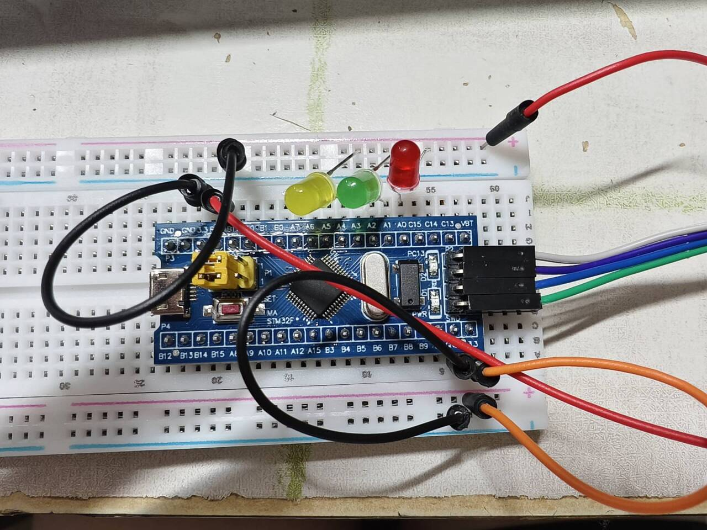


### 4.2 寄存器解析

:one:查阅 RCC 章节，找到RCC_APB2ENR 寄存器，确认 Bit2和Bit4分别为 GPIOA和GPIOC 端口时钟使能位，都为 RW 可读可写类型，置 1 可以开启 GPIOA和GPIOC 外设时钟，是使用 GPIOA 和GPIOC引脚的前提。如果不开启时钟，GPIO寄存器无法写入，引脚会没有反应。

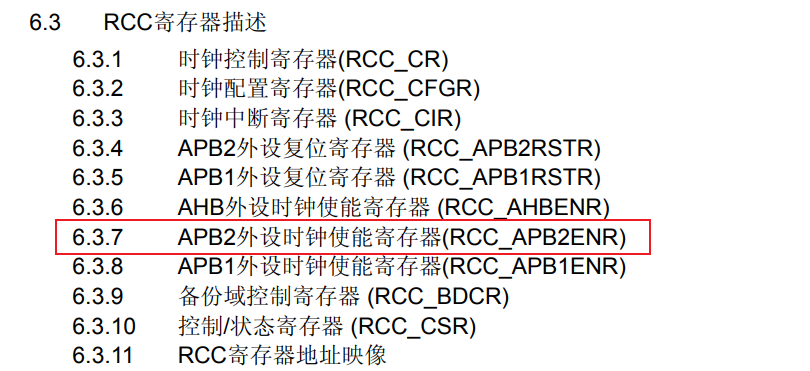

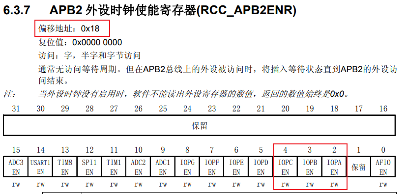

:two:查阅 GPIO 章节的GPIOx_CRL 端口配置低寄存器，该寄存器每 4 个 bit 控制一个 GPIO 引脚，通过配置 PA0、PA1、PA2 对应的 bit，将引脚设置为推挽输出、50MHz 输出速度。

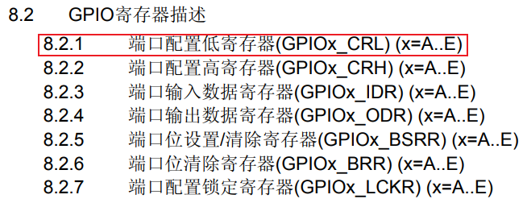

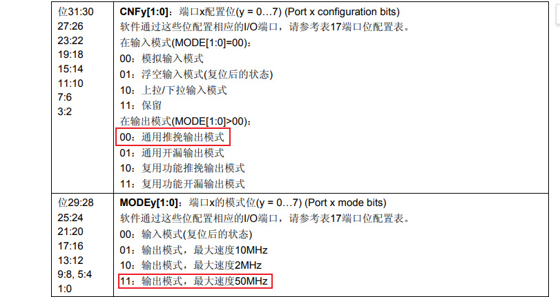

:three:查阅GPIO章节GPIOx_CRH端口配置高寄存器，该寄存器每4个bit控制一个位，PC13对应CRH的bit20~bit23，引脚设置为推挽输出，最大速度为50MHz。

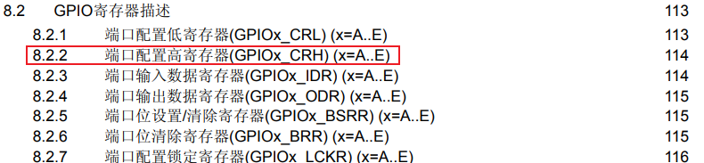

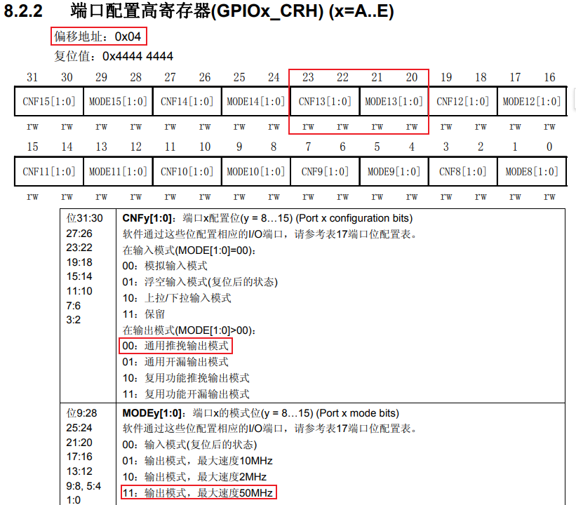

:four:查阅GPIOx_ODR 端口输出数据寄存器，寄存器 Bit0、Bit1、Bit2 分别对应 PA0、PA1、PA2 引脚，bit13对应PC13，修改对应 bit 的值，即可控制引脚输出高低电平，实现 LED 亮灭。

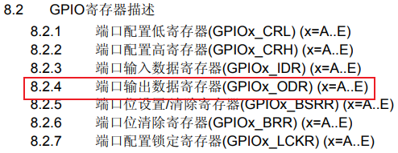

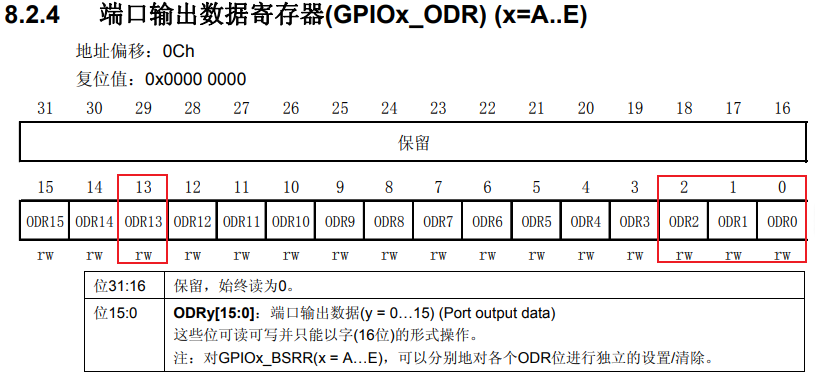


### 4.3 代码呈现

:one:外设时钟使能：STM32 外设上电默认关闭时钟，外设不供电，寄存器无法读写，GPIO 引脚不会响应电平控制，所以需要开启APB2外设时钟。

```c
RCC->APB2ENR |= (1 << 2);   // 使能GPIOA（bit2置1）时钟 
RCC->APB2ENR |= (1 << 4);   // 使能GPIOC（bit4置1）时钟
```

:two:时钟开启后，需要先清除引脚旧配置，然后再配置引脚工作模式，设置推挽输出模式，最大速度为50MHz。

```c
//配置PA0 PA1 PA2
	GPIOA->CRL &= 0xFFFF0000;    // 清空PA0~PA3配置位
	GPIOA->CRL |= 0x00003333;    //推挽输出，50MHz
//配置PC13
	GPIOC->CRH &= ~(0x0F << 20); // 清空PC13配置位
	GPIOC->CRH |=  (0x03 << 20); // 推挽输出，50MHz
```

:three:引脚电平初始化：本段代码将4个LED灯全部置高，上电初始状态全部灯熄灭。

```c
	GPIOA->ODR |= (1<<0) | (1<<1) | (1<<2);
	GPIOC->ODR |= (1<<13);
```

:four:主循环流水：while(1)是单片机无限主循环，程序会不断循环执行内部代码。要保证任意时刻只有一个LED灯点亮，用delay_ms做延时控制。

```c
	while(1)
	{
		GPIOA->ODR &= ~(1 << 0);  // PA0亮
		GPIOA->ODR |= (1 << 1) | (1 << 2);
		GPIOC->ODR |= (1 << 13);
		Delay_ms(1000);
		
		GPIOA->ODR &= ~(1 << 1);  // PA1亮
		GPIOA->ODR |= (1 << 0) | (1 << 2);
		GPIOC->ODR |= (1 << 13);
		Delay_ms(1000);
		
		GPIOA->ODR &= ~(1 << 2);  // PA2亮
		GPIOA->ODR |= (1 << 0) | (1 << 1);
		GPIOC->ODR |= (1 << 13);
		Delay_ms(1000);
		
		GPIOC->ODR &= ~(1 << 13); // PC13亮
		GPIOA->ODR |= (1 << 0) | (1 << 1) | (1 << 2);
		Delay_ms(1000);
	}
}

```


### 4.4 效果展示

可以看到从PC13蓝色灯到黄色灯依次闪烁，实验成功。

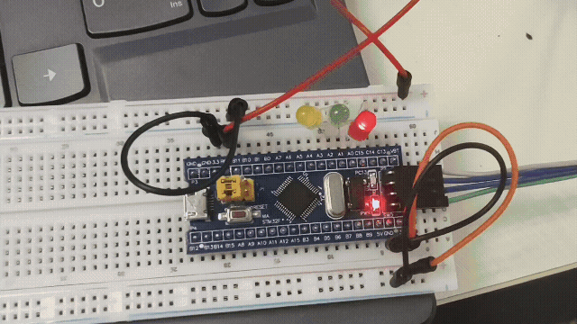


## 五、实验任务二：基于标准外设库的流水灯控制

### 5.1 工程创建

:one:在建立工程之前，需要建立一个存放工程的文件夹，然后打开Keil5新建一个project，project就存放在刚刚新建立的文件夹里面，在本文件夹里面再建立一个空的文件夹，用来存放本次工程，顺便给本次工程起一个名字。

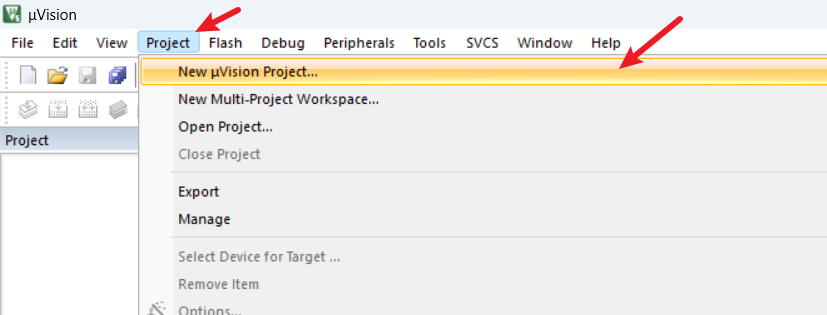

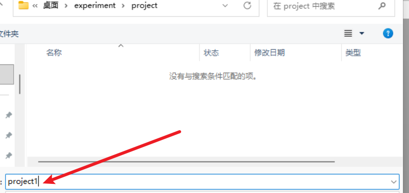

:two:选择型号，本次实验用的是STM32F103C8T6，所以就选这个型号。后续直接选“ok”就行

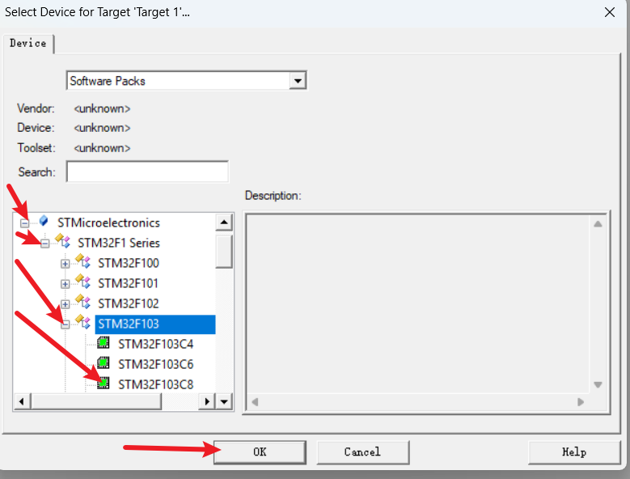

:three:打开固件库，根据以下图片的路径，找到这些文件，全部复制下来（固件库会打包放在最后），固件库获取链接也放在下面了，压缩包解压密码“32”。

相关资料获取链接：https://jiangxiekeji.com/download.html

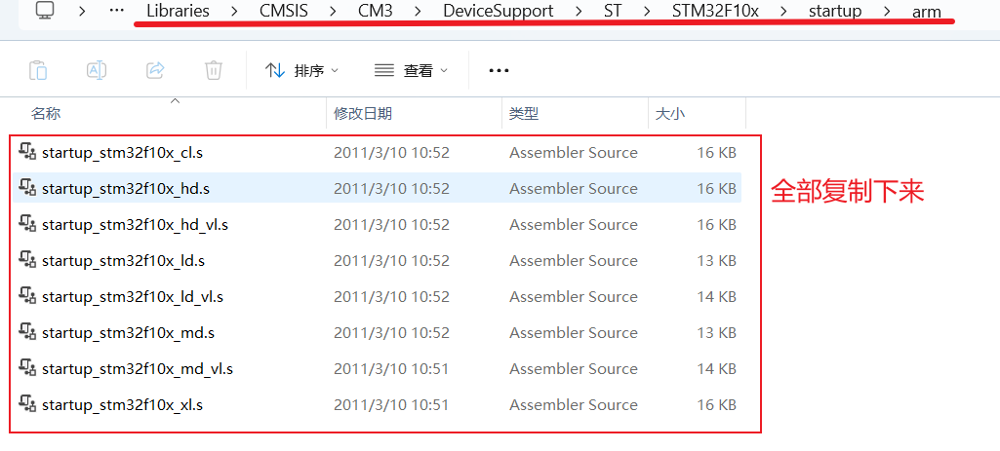

:four:回到刚刚建立的“project”文件夹，再新建一个放置刚刚复制的文件的文件夹“start”，然后把文件全部粘贴进去。

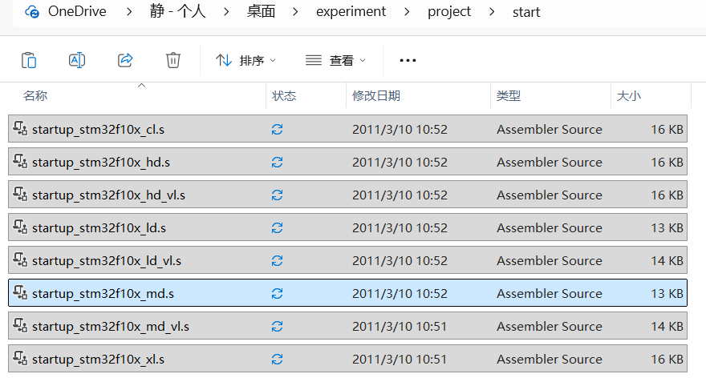

:five:回到路径STM32F10x，可以看到该文件夹里面有三个文件，stm32f10x是用来描述stm32是有那些寄存器和它对应的地址的，另外两个system文件是用来配置时钟的，所以需要将这三个文件也一并复制粘贴到刚刚建立的“start”文件夹里面。

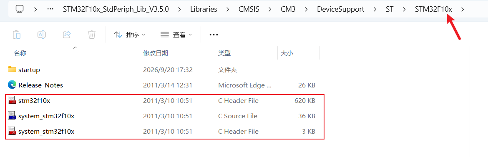

:six:根据以下路径找到这两个文件，这两个文件是内核的寄存器描述，粘贴复制到“start”文件。

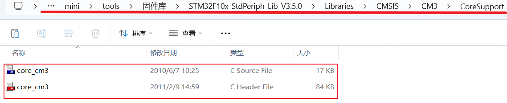

:seven:将start文件添加进工程

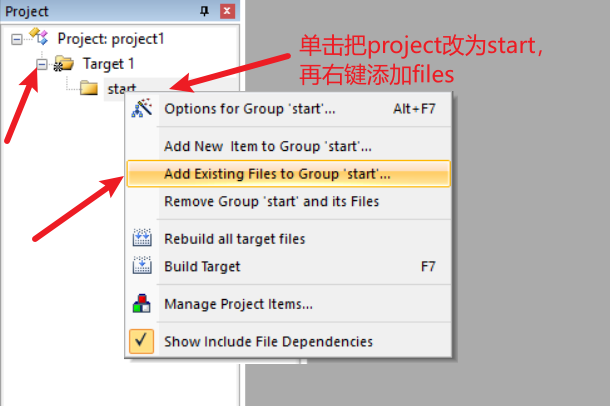

选好以下图片中的文件，再点击add→close，这些文件都是stm32中最基本的文件，是不需要我们去修改的。

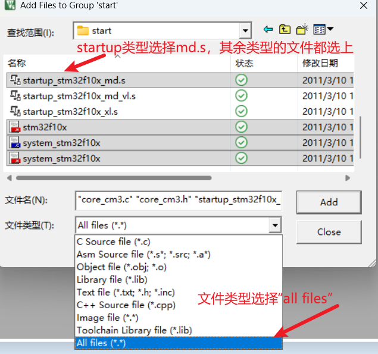

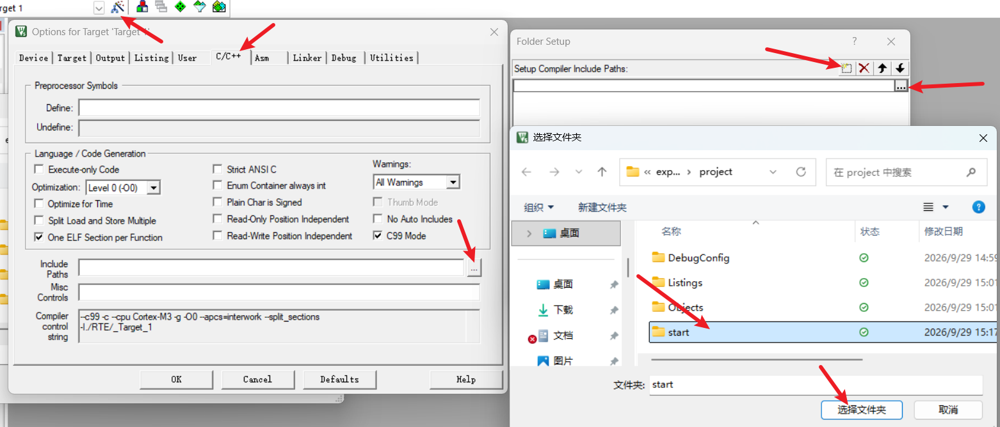

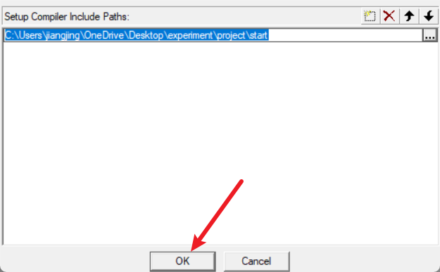

:eight:在project文件夹里面新建一个文件夹“user”，再按照以下图片进行操作。

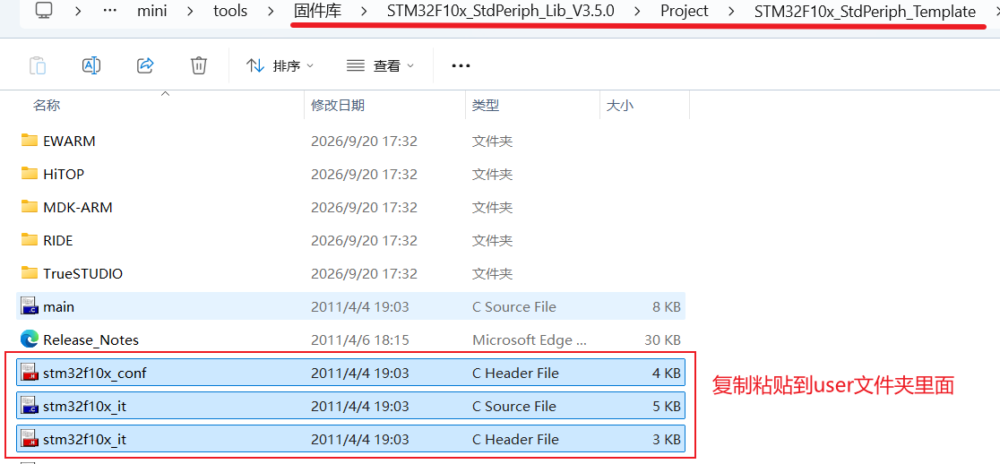

打开keil5，添加user文件进工程。

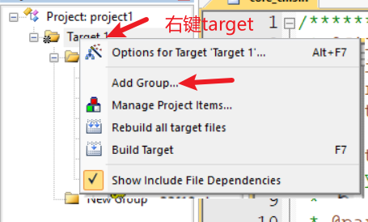


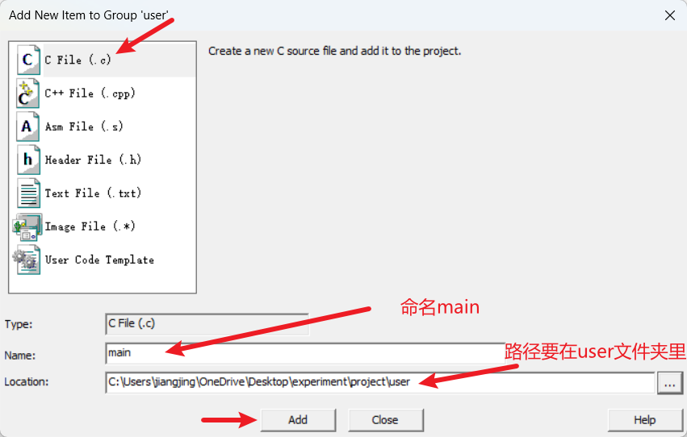

其他设置：接线选择st-link，勾上reset and run按键，这样代码一烧录进去就可以立马执行，不用再按复位键，比较方便。

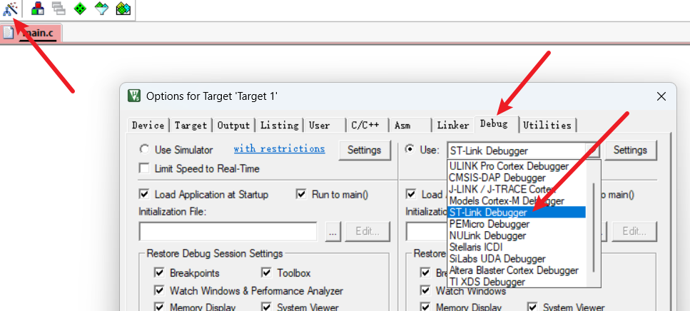

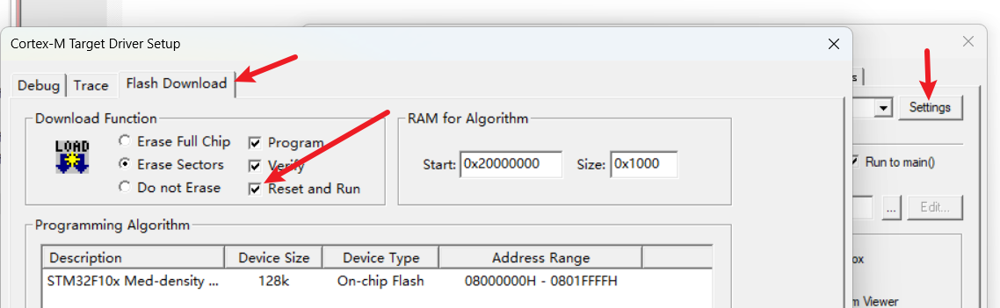

:nine:在project文件夹中新建library文件夹，用来存放库函数，按照以下图片进行操作。

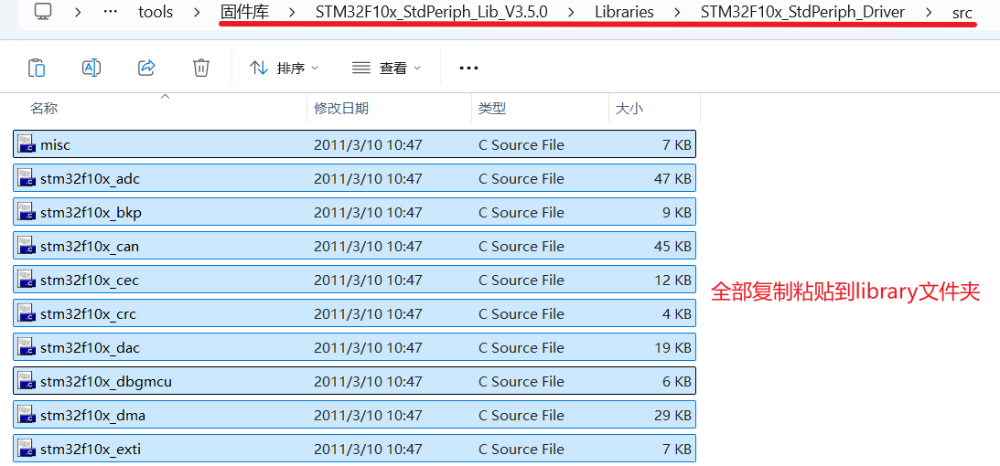

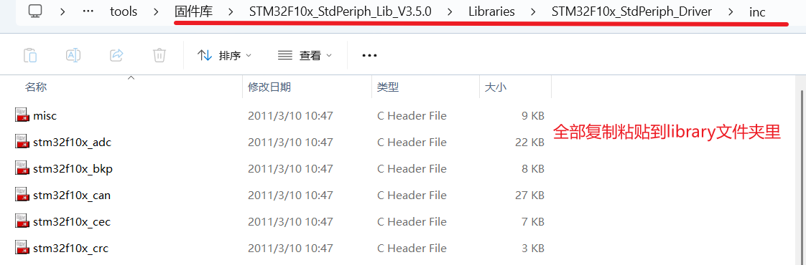

然后回到keil5，按照之前的步骤，将library文件添加进工程里。

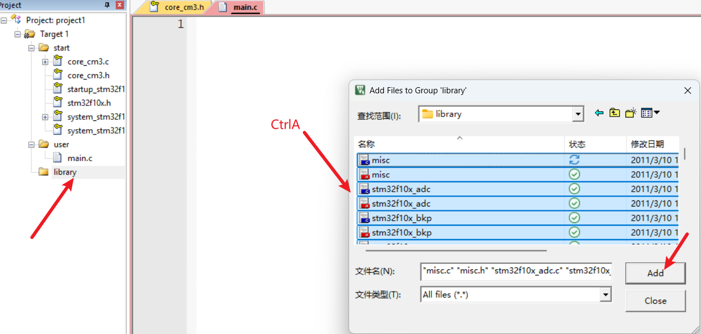

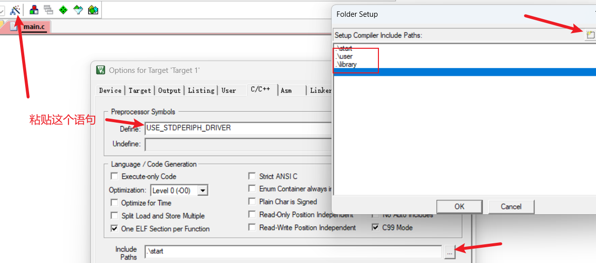

工程到这里就建立完成了，接下来可以编写代码了，库函数的前期配置还是有点麻烦，后面如果用库函数来控制单片机，可以把通用的文件先复制好，比如user、start文件夹，直接粘贴进新的文件夹里面。


### 5.2 代码呈现

:one:头文件引入：

stm32f10x.h，STM32F103 标准库核心头文件，里面包含 RCC、GPIO 所有外设结构体、函数、宏定义；Delay.h自定义延时函数头文件，提供Delay_ms()毫秒延时函数，用来控制每个 LED 点亮的停留时间。

```c
#include "stm32f10x.h" 
#include "Delay.h"
```

:two:结构体定义：

GPIO_InitTypeDef，标准库预先定义好的 GPIO 初始化结构体类型；GPIO_InitStructure是定义的结构体变量，用来存放引脚配置参数。

```c
int main(void)
{
	GPIO_InitTypeDef GPIO_InitStructure;

```

:three:开启外设时钟：

STM32 外设默认时钟关闭，外设不供电，不能工作；必须先开启时钟才能操作 GPIO。

```c
	//开启GPIOA、GPIOC的APB2外设时钟
	RCC_APB2PeriphClockCmd(RCC_APB2Periph_GPIOA, ENABLE);
	RCC_APB2PeriphClockCmd(RCC_APB2Periph_GPIOC, ENABLE);

```

:four:配置PA0、PA1、PA2引脚：

```c
	GPIO_InitStructure.GPIO_Pin = GPIO_Pin_0 | GPIO_Pin_1 | GPIO_Pin_2;
	GPIO_InitStructure.GPIO_Mode = GPIO_Mode_Out_PP;//推挽输出模式，驱动LED
	GPIO_InitStructure.GPIO_Speed = GPIO_Speed_50MHz;//最大翻转速度50MHz
	GPIO_Init(GPIOA, &GPIO_InitStructure);//把结构体中的配置写入GPIOA对应的寄存器，完成初始化
```

:five:配置PC13引脚：

复用上面同一个结构体变量，修改引脚为 Pin13，其他参数不变，对 GPIOC 端口初始化。 PC13 是开发板自带 LED 引脚，同样配置为推挽输出。

```c
	GPIO_InitStructure.GPIO_Pin = GPIO_Pin_13;
	GPIO_InitStructure.GPIO_Mode = GPIO_Mode_Out_PP;
	GPIO_InitStructure.GPIO_Speed = GPIO_Speed_50MHz;
	GPIO_Init(GPIOC, &GPIO_InitStructure);

```

:six:LED初始状态设置：

```c
	// 初始状态：所有LED熄灭
	GPIO_SetBits(GPIOA, GPIO_Pin_0 | GPIO_Pin_1 | GPIO_Pin_2);//配置高电平
	GPIO_SetBits(GPIOC, GPIO_Pin_13);
```

:seven:主循环

```c
	while(1)
	{
		GPIO_ResetBits(GPIOA, GPIO_Pin_0); 
        // PA0亮，resetbits把引脚置低电平，对应LED灯亮
		GPIO_SetBits(GPIOA, GPIO_Pin_1 | GPIO_Pin_2);
		GPIO_SetBits(GPIOC, GPIO_Pin_13);
		Delay_ms(1000);
		
		GPIO_ResetBits(GPIOA, GPIO_Pin_1);  // PA1亮
		GPIO_SetBits(GPIOA, GPIO_Pin_0 | GPIO_Pin_2);
		GPIO_SetBits(GPIOC, GPIO_Pin_13);
		Delay_ms(1000);
		
		GPIO_ResetBits(GPIOA, GPIO_Pin_2);  // PA2亮
		GPIO_SetBits(GPIOA, GPIO_Pin_0 | GPIO_Pin_1);
		GPIO_SetBits(GPIOC, GPIO_Pin_13);
		Delay_ms(1000);
		
		GPIO_ResetBits(GPIOC, GPIO_Pin_13); // PC13亮
		GPIO_SetBits(GPIOA, GPIO_Pin_0 | GPIO_Pin_1 | GPIO_Pin_2);
		Delay_ms(1000);
	}
}

```

理论上延时1000ms，但是这个延时存在微小误差，所以，不知道“完全”准确的周期。

### 5.3 GPIO输出仿真

:one:打开对应工程，按照以下步骤配置，然后点击编译，要确保0错误0警告。

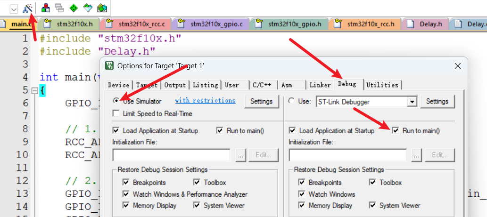

:two:点开频谱分析仪，添加引脚，按下F5，进行仿真。

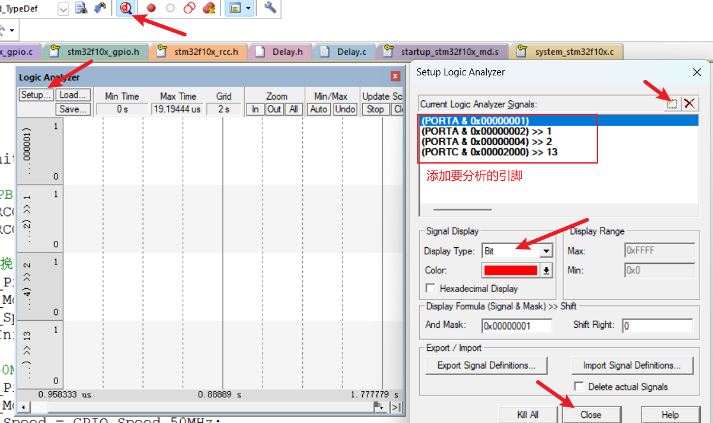

:three:可以看到波形正常，第一个灯亮了（低电平）之后，后续灯依次亮。

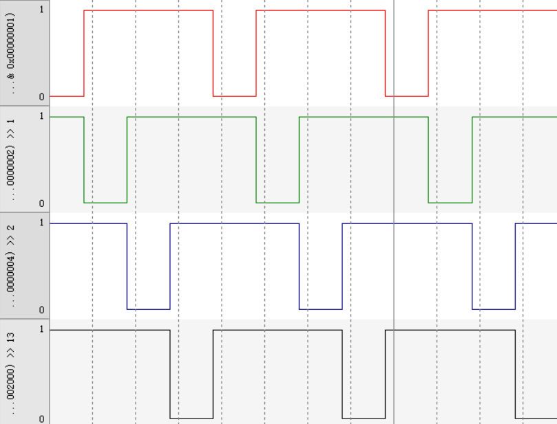


### 5.4 效果展示

接线图和第一个实验一样，所以这里不重复描述了，可以看到本次实验成功了。

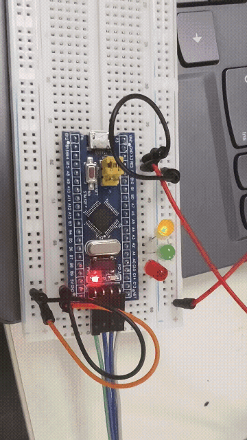


## 六、任务实验三：HAL库按键中断控制流水灯

### 6.1 逻辑设计：

:one:流水灯正常运行，按键按下时当前LED状态暂停，再次按下时，LED灯继续闪烁

:two:防抖与按键中断：通过外部中断（EXTI）实现该功能，机械按键存在抖动，按下和松开瞬间电平会出现短暂跳变，需要延时消抖，避免误识别多次按键。

:three:GPIO配置为上拉输入模式时，引脚默认为高电平；按键松下，引脚接地变为低电平；按键松开；内部上拉电阻把引脚拉回高电平。

:four:设置状态标志位run_flag，用来标记流水灯运行或暂停状态。为1时流水灯正常循环，为0时，流水灯停止，保持当前LED状态。当检测到按键有效按下时，对标志位取反，实现暂停/继续的效果。流水灯循环逻辑只有在run_flag=1的时候才执行，标志位为0时会跳过流水灯切换逻辑。


### 6.2 工程建立

使用HAL标准库，我是STM32Cube+Keil5搭配使用，软件前期的下载和配置过程我这里不过多描述，我是参考B站上的博主和教材来的，我将链接放在下方。

https://b23.tv/lmrn8fr

:one:打开STM32Cube MX，新建一个工程。

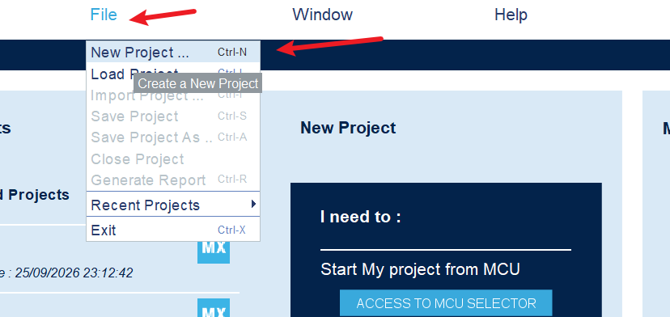


:two:芯片引脚配置：

PA0、PA1、PA2、PC13都设置为output模式，PB0（按键引脚）设置为EXTI0。

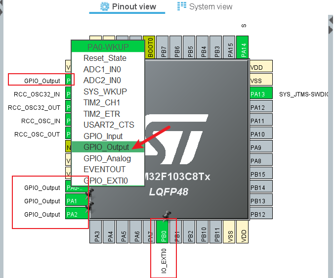

:three:配置GPIO参数，点开左侧System Core → GPIO；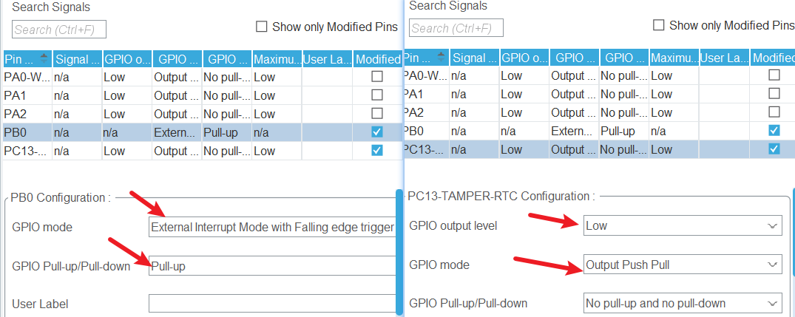

:four:NVIC设置：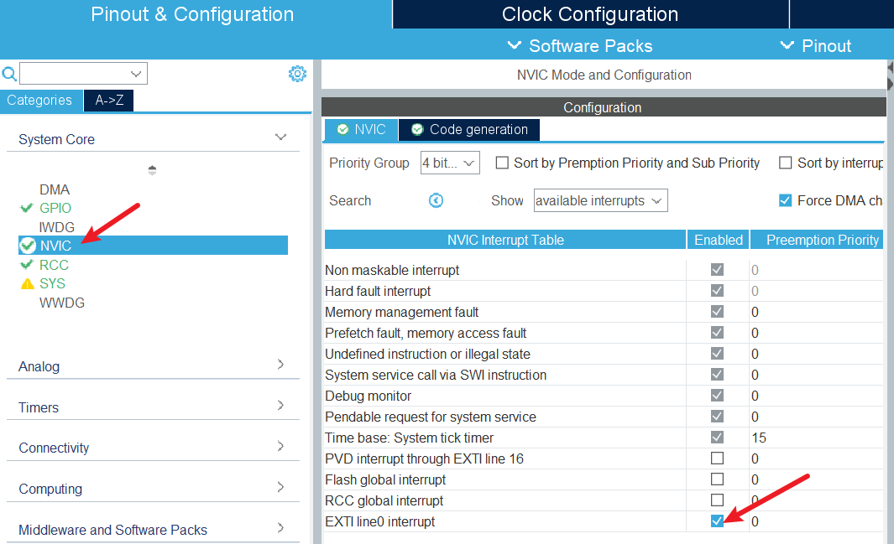

:five:时钟配置：

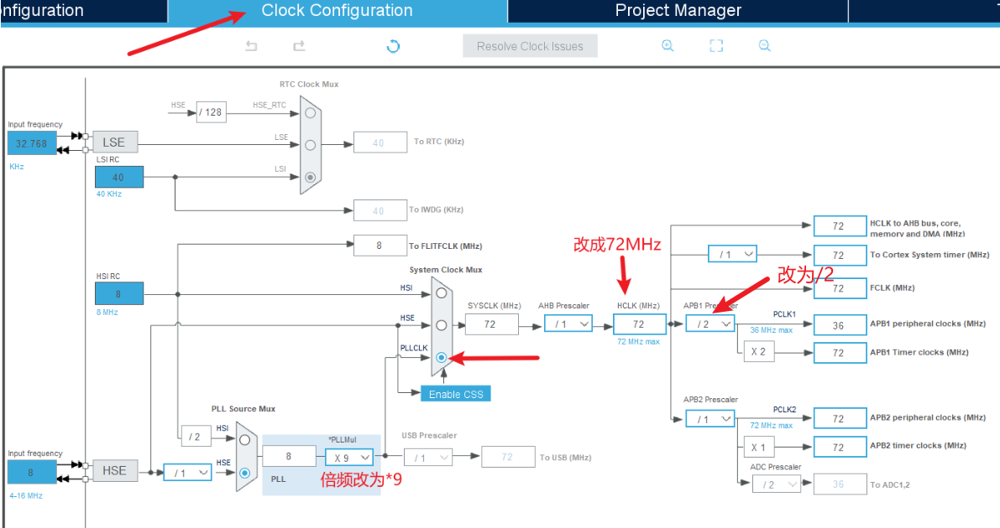

:six:完成以下图片中的设置，就可以点击上方“create code”生成工程。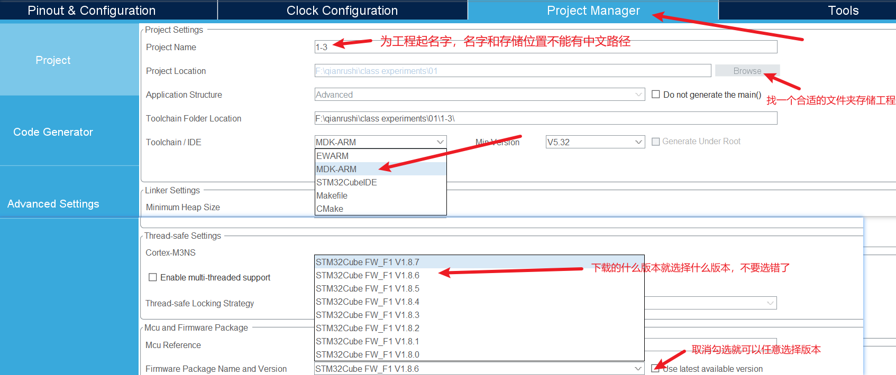

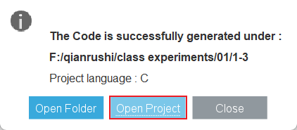

### 6.3 代码呈现

:one:全局变量：

```c
/* USER CODE BEGIN PV */
uint8_t run_flag = 1;	//run_flag：流水启停标志
uint8_t led_state = 0;	//led_state：流水灯状态机序号
uint8_t key_flag = 0;	//key_flag：中断事件标志
/* USER CODE END PV */

```

:two:while主循环：

```c
while (1)
{
    /* USER CODE END WHILE */
if(key_flag == 1)	//代表收到中断的按键通知
{
  HAL_Delay(20);
  if(HAL_GPIO_ReadPin(GPIOB, GPIO_PIN_0) == GPIO_PIN_RESET)
  {
    run_flag = !run_flag;	//翻转run_flag实现启停切换
  }
  key_flag = 0;	//清零，等待下一次中断
}
if(run_flag == 1)	//执行流水
{
  HAL_GPIO_WritePin(GPIOC, GPIO_PIN_13, GPIO_PIN_SET);
  HAL_GPIO_WritePin(GPIOA, GPIO_PIN_0, GPIO_PIN_SET);
  HAL_GPIO_WritePin(GPIOA, GPIO_PIN_1, GPIO_PIN_SET);
  HAL_GPIO_WritePin(GPIOA, GPIO_PIN_2, GPIO_PIN_SET);
  switch(led_state)
  {
    case 0:
      HAL_GPIO_WritePin(GPIOC, GPIO_PIN_13, GPIO_PIN_RESET);
      break;
    case 1:
      HAL_GPIO_WritePin(GPIOA, GPIO_PIN_0, GPIO_PIN_RESET);
      break;
    case 2:
      HAL_GPIO_WritePin(GPIOA, GPIO_PIN_1, GPIO_PIN_RESET);
      break;
    case 3:
      HAL_GPIO_WritePin(GPIOA, GPIO_PIN_2, GPIO_PIN_RESET);
      break;
  }
  HAL_Delay(1000);	//延时1000ms
  led_state++;
  if(led_state >= 4)
  {
    led_state = 0;	//计数到4清零
  }
}
/* USER CODE BEGIN 3 */
  }
```

:three:外部中断回调函数：

```c
/* USER CODE BEGIN 4 */
void HAL_GPIO_EXTI_Callback(uint16_t GPIO_Pin)
{
  if(GPIO_Pin == GPIO_PIN_0)	//判断触发中断引脚为PB0，仅把 key_flag置1
  {
    key_flag = 1;
  }
}
/* USER CODE END 4 */

```


### 6.4 效果展现

接线和前面的实验一致，在PB0引脚处接了一个2脚的按键，一个脚接引脚，一个脚接负极，可以看到本次实验成功了。

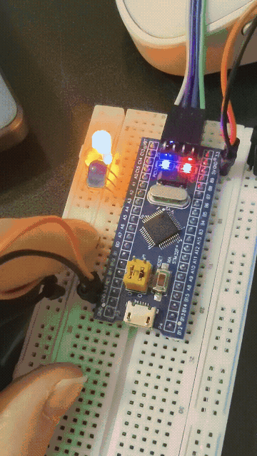


## 七、实验总结

通过本次完整的流水灯系列实验，我依次使用寄存器、标准库、以及HAL库外部中断四种方式实现了相同的流水灯功能，系统对比了三种开发方式。

纯寄存器开发最贴近硬件底层，能够深入理解寄存器偏移地址、位配置、时钟使能等底层原理，执行效率高、资源占用小，但代码繁琐、可读性差、开发效率低，适合底层学习与极致性能开发；标准库开发对寄存器进行了适度封装，代码结构清晰、开发难度适中、稳定性强，是学习STM32外设驱动的过渡方式，适合课堂实验与常规基础项目开发；HAL库依托CubeMX图形化配置，极大简化了底层初始化代码，开发速度快、标准化程度高、可移植性强，适配企业快速开发场景，但封装层级较高，对底层硬件原理的透明性较低。

三种开发方式层层递进，让我完整掌握了STM32 GPIO输出、GPIO输入、软件扫描按键、外部中断的工作逻辑，形成了从底层寄存器到高层库函数的完整开发认知。

本次实验过程中我遇到了较多典型问题，并通过逐步排查最终全部解决。在前期工程配置阶段，由于CubeMX配置步骤不完整、遗漏了NVIC中断使能相关设置，导致工程初始化异常、代码运行错误，重新检查并且完整配置后，工程恢复正常运行；在按键功能调试阶段，多次出现按键无反应、触发不稳定、偶尔多次误触发的问题，主要原因是机械按键存在电平抖动，且外部中断对电平跳变极其敏感，后期采用“中断仅置标志位、主循环软件消抖处理业务”的规范写法，有效解决了按键抖动、漏触发、误触发的问题。

经过本次整套流水灯递进实验，我深刻体会到STM32开发配置严谨性的重要性，任何一处配置遗漏或代码逻辑错误都会导致整体功能异常。从最基础的寄存器手动配置，到标准库函数调用，再到HAL库图形化配置与中断编程，我不仅掌握了GPIO输入输出、按键检测、外部中断的核心知识点，还养成了规范的代码编写习惯与循序渐进的排错思维。本次实验解决问题的过程，极大提升了我的调试能力与硬件分析能力，充分理解了中断“快进快出、只做标记”的工程原则，为后续更加复杂实验的学习打下了扎实的基础。
